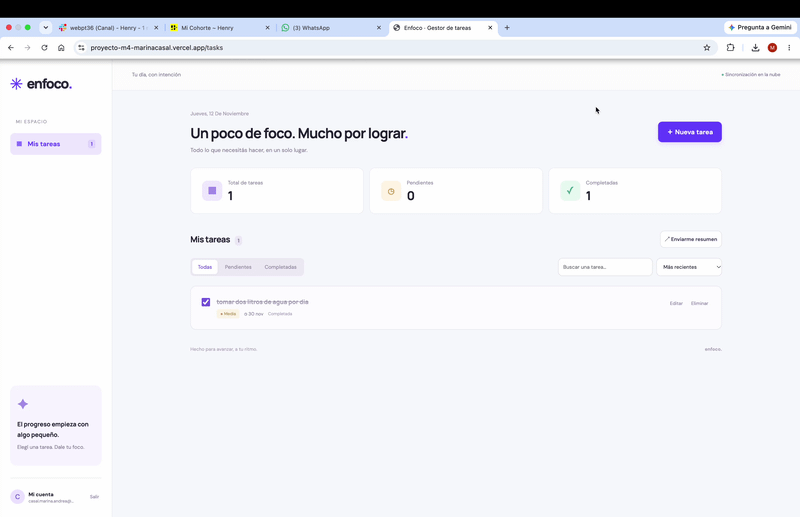

# ✳️ Enfoco · Gestor estratégico de tareas

Aplicación web SPA para organizar tareas personales, establecer prioridades y recibir un resumen por email.

Proyecto Integrador M4 · Full Stack · Marina Casal

## 🎬 Demo de Enfoco



## 🌐 Enlaces

- **Aplicación:** https://proyecto-m4-marinacasal.vercel.app
- **Repositorio:** https://github.com/casalmarinaandrea-ops/ProyectoM4_MARINACASAL

## 🚀 Estado del proyecto

Aplicación desplegada en Vercel, conectada con Firebase Authentication y Cloud Firestore.

Se comprobó manualmente el registro, la persistencia de tareas, la edición, el completado y la eliminación. También se confirmó la recepción de un resumen real por email mediante AWS SES desde la aplicación publicada.

## ✅ Funcionalidades

- 🔐 Registro con email y contraseña, inicio y cierre de sesión.
- 🛡️ Protección de rutas privadas.
- 📝 Creación de tareas con título y descripción.
- ✏️ Edición de tareas.
- 🗑️ Eliminación con confirmación.
- ☑️ Marcado de tareas completadas.
- ☁️ Persistencia y sincronización con Cloud Firestore.
- 👤 Acceso a tareas por usuario autenticado.
- 🔎 Búsqueda por título y descripción.
- 🗂️ Filtros para todas las tareas, pendientes y completadas.
- 🚩 Prioridades alta, media y baja.
- 📅 Fecha de vencimiento opcional.
- ↕️ Orden por prioridad, vencimiento o fecha de creación.
- 📊 Contadores de tareas totales, pendientes y completadas.
- 📧 Envío de un resumen de todas las tareas al email del usuario.
- 📱 Interfaz responsive con estados de carga y mensajes de error.

## 🛠️ Tecnologías

| Área | Tecnologías |
| --- | --- |
| Frontend | React 19, TypeScript y Vite |
| Navegación | React Router |
| Autenticación | Firebase Authentication |
| Base de datos | Cloud Firestore |
| Servidor | Vercel Functions y Firebase Admin SDK |
| Email | AWS SES y AWS SDK |
| Testing | Vitest y React Testing Library |
| Despliegue | Vercel |
| Control de versiones | Git y GitHub |

## 💻 Instalación local

### Requisitos

- Node.js 22 o posterior.
- npm.
- Un proyecto Firebase con Authentication y Firestore.
- Para el envío de emails: configuración de Firebase Admin y AWS SES.

### 1. Clonar el repositorio

```bash
git clone https://github.com/casalmarinaandrea-ops/ProyectoM4_MARINACASAL.git
cd ProyectoM4_MARINACASAL
```

### 2. Instalar dependencias

```bash
npm ci
```

### 3. Crear el archivo de entorno

```bash
cp .env.example .env
```

En Windows PowerShell:

```powershell
Copy-Item .env.example .env
```

Completar las variables del archivo `.env` con la configuración del entorno propio.

### 4. Configurar Firebase

1. Registrar una aplicación web en Firebase.
2. Copiar su configuración en las cuatro variables `VITE_FIREBASE_`.
3. Habilitar **Correo electrónico/contraseña** en Authentication.
4. Crear una base de datos Cloud Firestore con identificador `(default)`.
5. Publicar el contenido de `firestore.rules` en las reglas de esa base de datos.

### 5. Ejecutar el frontend

```bash
npm run dev
```

Abrir la dirección indicada por Vite en la terminal.

Para ejecutar también la función de email localmente:

```bash
npm run dev:full
```

Este comando requiere iniciar sesión en Vercel CLI, vincular el proyecto y configurar las variables del servidor. El servidor de Vite por sí solo no ejecuta `/api/send-summary`.

## ⚙️ Scripts disponibles

| Comando | Descripción |
| --- | --- |
| `npm run dev` | Inicia el frontend con Vite |
| `npm run dev:full` | Ejecuta el entorno local con Vercel CLI |
| `npm test` | Ejecuta la suite de tests |
| `npm run test:watch` | Ejecuta los tests en modo interactivo |
| `npm run test:coverage` | Genera el informe de cobertura |
| `npm run build` | Comprueba TypeScript y compila el frontend |
| `npm run preview` | Sirve la compilación local, sin ejecutar la función de email |

## 🏗️ Arquitectura

El código separa las vistas, los componentes, la lógica de estado y las integraciones externas.

| Carpeta o archivo | Responsabilidad |
| --- | --- |
| `src/pages` | Vistas de autenticación y tareas |
| `src/components` | Formulario, lista, modal y marca |
| `src/features/auth` | Contexto y seguimiento de la sesión |
| `src/hooks` | Acceso a la sesión y suscripción a tareas |
| `src/routes` | Protección de rutas privadas |
| `src/services` | Integraciones con Firebase y API de email |
| `src/types` | Tipos y contratos compartidos |
| `src/utils` | Validaciones, filtros, estadísticas y errores |
| `api/send-summary.ts` | Endpoint de la función de Vercel |
| `server` | Autenticación del servidor, consulta de tareas y envío con SES |
| `tests` | Tests unitarios, componentes y mocks |
| `firestore.rules` | Reglas de autorización y validación |
| `.github/workflows` | Automatización de tests y compilación |

### 🧩 Decisiones principales

- **Context para la sesión:** permite compartir el estado de autenticación entre componentes.
- **Estado local para formularios y filtros:** mantiene los datos temporales cerca de la vista que los utiliza.
- **Suscripción con `onSnapshot`:** actualiza la interfaz cuando cambian los documentos.
- **Servicios separados:** concentran las llamadas a Firebase y al endpoint de email.
- **Campos explícitos en las escrituras:** la edición envía únicamente los campos modificables y conserva el propietario y la fecha de creación.
- **Fechas de vencimiento como `YYYY-MM-DD`:** representan un día de calendario sin convertirlo a un instante UTC.
- **Timestamps de servidor:** registran la creación y la última modificación.

## 🔐 Autenticación y seguridad

Las rutas públicas son `/login` y `/register`. La vista `/tasks` requiere una sesión activa.

Las tareas se almacenan en:

```text
users/{uid}/tasks/{taskId}
```

Cada documento también contiene `userId`. La consulta filtra por ese campo y las reglas exigen que el usuario autenticado coincida con el UID de la ruta.

Las reglas validan los campos, tipos, longitudes, prioridades y timestamps. Además, impiden modificar el propietario o la fecha de creación.

La función de email verifica el Firebase ID token en el servidor. El UID y el destinatario se obtienen de la identidad autenticada.

## 🔑 Variables de entorno

| Variable | Entorno | Descripción |
| --- | --- | --- |
| `VITE_FIREBASE_API_KEY` | Frontend | API key de la aplicación web |
| `VITE_FIREBASE_AUTH_DOMAIN` | Frontend | Dominio de autenticación |
| `VITE_FIREBASE_PROJECT_ID` | Frontend | Identificador del proyecto |
| `VITE_FIREBASE_APP_ID` | Frontend | Identificador de la aplicación |
| `FIREBASE_PROJECT_ID` | Servidor | Proyecto de la cuenta de servicio |
| `FIREBASE_CLIENT_EMAIL` | Servidor | Email de la cuenta de servicio |
| `FIREBASE_PRIVATE_KEY` | Servidor | Clave privada de Firebase Admin |
| `AWS_REGION` | Servidor | Región de SES; el despliegue utiliza `us-east-2` |
| `AWS_ACCESS_KEY_ID` | Servidor | Clave de acceso del usuario IAM |
| `AWS_SECRET_ACCESS_KEY` | Servidor | Clave secreta del usuario IAM |
| `SES_FROM_EMAIL` | Servidor | Dirección remitente verificada en SES |

La configuración web de Firebase se incorpora al frontend. El acceso a los datos se protege mediante Authentication y las reglas de Firestore.

Las credenciales de Firebase Admin y AWS son exclusivas del servidor y no llevan el prefijo `VITE_`.

El archivo `.env` está excluido mediante `.gitignore`. El repositorio incluye `.env.example` como plantilla sin credenciales.

`FIREBASE_PRIVATE_KEY` admite saltos de línea reales o secuencias `\n`.

## 📧 Flujo de envío de emails

1. El usuario pulsa **Enviarme resumen**.
2. El frontend obtiene su Firebase ID token.
3. Envía una solicitud `POST /api/send-summary` con el token en el encabezado `Authorization`.
4. La función verifica el token, comprueba su revocación y consulta el email actual del usuario.
5. Una transacción en `emailLimits/{uid}` limita los intentos a uno cada 60 segundos.
6. El servidor consulta todas las tareas de ese usuario.
7. Genera un resumen en HTML y texto con títulos, descripciones, estados, prioridades, vencimientos y totales.
8. AWS SES procesa el envío y la interfaz informa el resultado.

El resumen incluye todas las tareas, independientemente de los filtros activos en pantalla.

El contenido ingresado por el usuario se escapa antes de incluirlo en el HTML. No se aceptan destinatarios ni listas de tareas enviados desde el navegador.

### ☁️ Configuración de AWS SES

El despliegue utiliza **Estados Unidos — Ohio (`us-east-2`)**.

Para configurar otro entorno:

1. Verificar el remitente en SES.
2. Si la cuenta está en sandbox, verificar también los destinatarios de prueba.
3. Crear un usuario IAM con permiso `ses:SendEmail` sobre la identidad remitente.
4. Crear una clave de acceso de API para ese usuario.
5. Guardar las credenciales, la región y el remitente como variables del servidor en Vercel.
6. Realizar un nuevo despliegue.

Las credenciales utilizadas son claves de API IAM, no credenciales SMTP.

La disponibilidad de envío a destinatarios no verificados depende del estado sandbox o producción de la cuenta SES. La recepción real se comprobó con una casilla verificada.

## 🧪 Testing y validación

La suite incluye pruebas de:

- Validación de títulos, descripciones, prioridades y fechas.
- Filtrado, búsqueda, orden y estadísticas.
- Formulario de creación y edición.
- Mensajes de error durante el guardado.
- Lista de tareas, acciones y estado vacío.
- Redirección de rutas privadas sin sesión.
- Validación de tokens en el flujo de email.
- Consulta de tareas según el UID autenticado.
- Límite de intentos de envío.
- Escape de contenido HTML.
- Respuestas HTTP y errores del servicio de email.

Los tests utilizan mocks y callbacks controlados para aislar las dependencias externas. Ejecutarlos no envía correos reales.

```bash
npm test
npm run build
```

La validación inicial registró **27 tests aprobados** y compilación correcta. Después se realizaron pruebas manuales del CRUD con Firebase y se confirmó la recepción de un email desde la aplicación desplegada.

El workflow de GitHub Actions está configurado para ejecutar tests y compilación en cada push y pull request.

## 🌍 Despliegue en Vercel

| Configuración | Valor |
| --- | --- |
| Framework | Vite |
| Directorio raíz | Raíz del repositorio |
| Build command | `npm run build` |
| Output directory | `dist` |
| Node.js | 22.x |

Las variables de entorno se configuran en el proyecto de Vercel. Los cambios de variables requieren un nuevo despliegue.

Los rewrites de `vercel.json` permiten acceder directamente a `/login`, `/register` y `/tasks` sin interceptar el endpoint `/api/send-summary`.

Para reproducir la configuración, agregar el dominio publicado a los dominios autorizados de Firebase Authentication.

## 🤖 Uso de inteligencia artificial

Se utilizó ChatGPT como apoyo para generar la estructura inicial, implementar componentes e integraciones, preparar tests, redactar documentación y resolver errores durante la configuración y las pruebas.

Las instrucciones se centraron en construir una SPA con React y TypeScript, implementar un CRUD por usuario con Firebase, proteger los datos mediante reglas y enviar resúmenes con AWS SES desde una función autenticada.

La asistencia resultó especialmente útil para separar responsabilidades, definir tipos y contemplar casos de error. Durante la prueba manual se detectó y corrigió un problema de edición que enviaba campos adicionales a Firestore.

El proyecto aplica patrones como Context para la sesión, hooks de suscripción, formularios controlados, servicios separados y dependencias sustituibles en tests.

## 📚 Referencias oficiales

- [Firebase Authentication y reglas de seguridad](https://firebase.google.com/docs/rules/rules-and-auth)
- [Verificación de Firebase ID tokens](https://firebase.google.com/docs/auth/admin/verify-id-tokens)
- [Vite en Vercel](https://vercel.com/docs/frameworks/frontend/vite)
- [AWS SES — SendEmail](https://docs.aws.amazon.com/ses/latest/APIReference/API_SendEmail.html)
